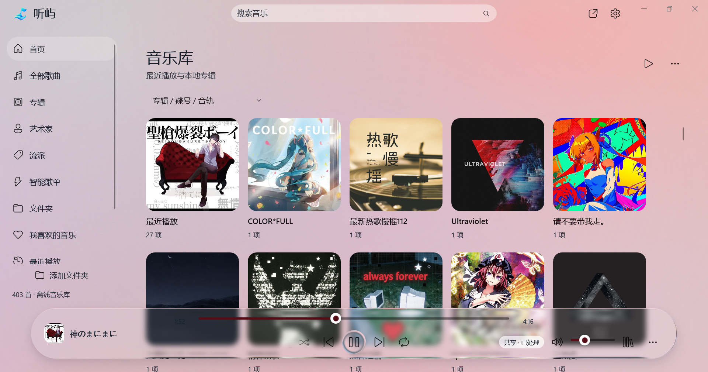
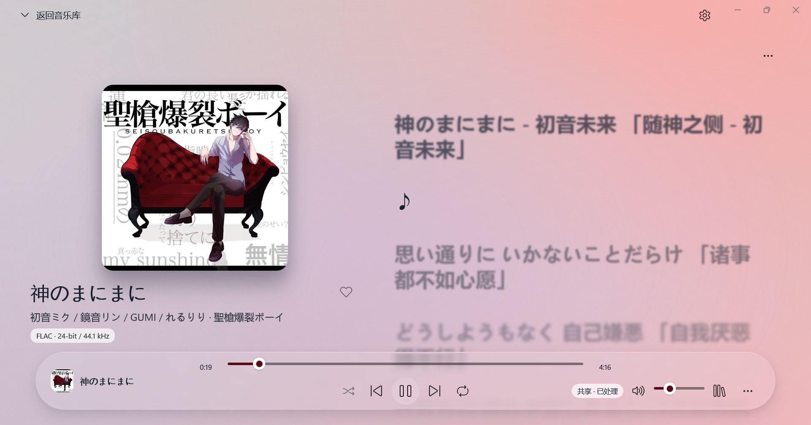

# 听屿 · Tingyu Music

[下载正式版](https://github.com/muyuawa/tingyu-music/releases/latest)

Windows x64 本地离线音乐播放器，支持专辑取色动态背景、Liquid Glass 播放控制条、同步歌词和 WASAPI / ASIO 音频输出。

## 界面预览

## 安装与更新

运行 Tingyu-1.0.1-win-x64.msi。需要 Windows 10 2004 或更新的 64 位系统。首次安装选择父文件夹，程序自动放入英文 Tingyu 子文件夹。检测到已有版本后使用原位置更新，不重复创建子文件夹。更新前请从托盘退出播放器。 安装器按需请求系统权限；播放器运行无需管理员权限。安装不保留回滚备份，中断后请重新运行安装包修复。

安装程序会保存安装目录，后续更新优先使用该位置。旧版通过安装记录、开始菜单快捷方式和原有默认目录识别。更新保留音乐库与个人设置；卸载会清除应用的数据、设置、歌单、记录及缓存，不删除导入的原始歌曲文件。需要保留的数据请在卸载前自行备份。

便携版：完整解压 ZIP 后运行 Muyu.App.exe；不要单独移动程序，保留 portable.marker、Assets、audio-host 和运行库。便携数据在相邻 data，新安装版数据在 %LOCALAPPDATA%\MuyuMusic。从旧便携目录原位更新时保留原有数据位置。

## 开始使用

- 通过右上角“···”添加音乐文件或音乐文件夹，也可拖入本地文件。
- 歌曲可按标题、艺术家、专辑、采样率、时长、文件修改时间或添加时间排序。
- 双击歌曲播放。播放页显示大封面与同步歌词，点击“返回音乐库”恢复浏览。
- 歌词支持同名 LRC、内嵌歌词和歌词来源管理，手动浏览后可点“回到当前”。
- 队列支持点击切歌、多选和调整待播顺序；智能歌单按自定义规则筛选本地歌曲。
- 设置支持主题、主色调、播放背景模糊、玻璃模糊、减少动态和性能模式。

## 音频与音量

日常使用可选择 WASAPI 共享，与浏览器和其他应用同时播放。独占模式播放期间占用所选设备，暂停时释放。

原始输出保持数字增益 1.0。独占模式若设备没有硬件音量控制，请使用设备旋钮，或主动选择软件音量。软件音量支持 -40～+12 dB、0.1 dB 步进和完全静音；正增益过大会造成削波。共享模式可使用会话音量。

音量、重采样等处理仅作用于播放数据，不修改原始音乐文件。设备与兼容格式可在设置中的“音频”调整。

## 默认快捷键

| 按键 | 操作 |
| --- | --- |
| Space | 播放 / 暂停 |
| Ctrl+O | 打开音频文件 |
| Ctrl+Shift+O | 添加文件夹 |
| Ctrl+F | 搜索 |
| Ctrl+Z | 撤销队列操作 |
| Ctrl+Left / Ctrl+Right | 上一首 / 下一首 |
| Ctrl+S | 停止 |
| Ctrl+M | Mini 窗口 |
| Ctrl+Shift+L | 桌面歌词 |

可在设置中自定义。输入框保留文字编辑，对话框与选择控件保留自身的键盘操作。

## 数据与许可

移出音乐库只移除索引，不删除音乐文件。升级前可备份数据目录。异常退出和播放失败的本地错误记录不会自动上传。

第三方许可见 THIRD_PARTY_NOTICES.md 和 licenses；相关依赖源码和重建说明位于 licenses/sources，应用源码单独提供。歌词扩展说明见 EXTENSIONS.md。

